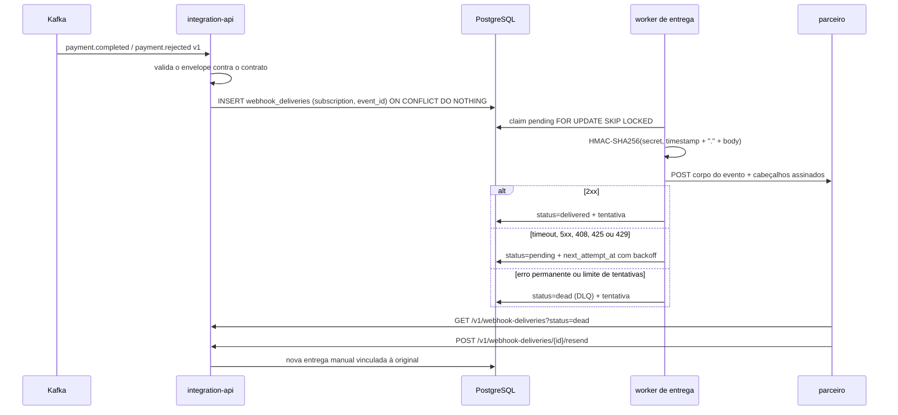

# Webhooks confiáveis: HMAC, retry e DLQ

| Campo | Valor |
| ----- | ----- |
| Status | Implementado |
| Autor | Luis Felipe (com apoio de execução via Gartrol/OpenCode) |
| Data | 2026-11-09 |
| Depende de | [Integration API para parceiros simulados](integration-api-parceiros.md), [Kafka, tópicos versionados e contratos de eventos](kafka-eventos-versionados.md), [Consumidor idempotente, inbox e replay](inbox-idempotencia-replay.md) |
| Missão | M3 · Mensageria e integrações (semanas 9–12) |

## Objetivo

Entregar os eventos de pagamento aos parceiros com garantia verificável: assinatura
HMAC-SHA256 com timestamp, fila durável, retry com backoff, dead-letter queue (DLQ),
histórico auditável e reenvio manual controlado (RF-11 e RNF-06).

A entrega é **at-least-once**. O receptor precisa deduplicar por `X-PayCore-Event-Id`; o
serviço reduz duplicatas na origem com a unicidade `(subscription_id, event_id)`, mas uma
falha entre o POST bem-sucedido e a confirmação no banco pode repetir a entrega. O efeito
financeiro já é idempotente na inbox do núcleo (card 3).

## 1. Fluxo



O consumidor Kafka só conecta com `PAYCORE_WEBHOOK_KAFKA_ENABLED=1`. O worker é um
processo separado dentro do mesmo serviço; testes o desligam
(`PAYCORE_WEBHOOK_WORKER_ENABLED=0`) e chamam `processDue({ now })` para controlar o tempo.

## 2. Contrato da entrega

O corpo é exatamente o envelope publicado no Kafka, sem campos adicionais:

```json
{
  "event_id": "4d8f5f9e-5a5c-4f37-b1e2-46a8a8f0b3a1",
  "event_type": "payment.completed",
  "event_version": 1,
  "occurred_at": "2026-11-09T12:00:00Z",
  "correlation_id": "b1f1d0de-6f7f-4d0a-9b0e-3ad0a2c9e9c4",
  "aggregate": { "type": "payment", "id": "..." },
  "data": { "transferId": "...", "state": "COMPLETED", "amount": 1500, "...": "..." }
}
```

Metadados de entrega não poluem o contrato; vão nos cabeçalhos:

| Cabeçalho | Conteúdo |
| --------- | -------- |
| `X-PayCore-Webhook-Id` | Inscrição que originou a entrega. |
| `X-PayCore-Delivery-Id` | Identificador lógico da entrega, estável entre retries. |
| `X-PayCore-Event-Id` | `event_id` do envelope; chave de deduplicação do receptor. |
| `X-PayCore-Event-Type` | `payment.completed` ou `payment.rejected`. |
| `X-PayCore-Attempt` | Tentativa atual, começando em `1`. |
| `X-PayCore-Timestamp` | Unix timestamp em segundos. |
| `X-PayCore-Signature` | `v1=<hex HMAC-SHA256(secret, "${timestamp}.${corpo}")>`. |

O corpo assinado é o texto exato persistido e reenviado em retries. O timestamp é renovado
a cada tentativa; portanto a assinatura também muda. O receptor deve recalcular o HMAC
sobre o corpo bruto, comparar em tempo constante e recusar timestamp fora da janela
recomendada de 5 minutos. O segredo `whsec_…` é devolvido apenas na criação do webhook.

Exemplo de verificação em Node.js:

```js
import { createHmac, timingSafeEqual } from 'node:crypto';

function verify(secret, timestamp, rawBody, signature) {
  const expected = `v1=${createHmac('sha256', secret)
    .update(`${timestamp}.${rawBody}`)
    .digest('hex')}`;
  return timingSafeEqual(Buffer.from(expected), Buffer.from(signature));
}
```

## 3. Fila, retry e DLQ

`webhook_deliveries` é a fila durável e o histórico. O claim usa:

```sql
UPDATE webhook_deliveries ...
WHERE id IN (
  SELECT id FROM webhook_deliveries
  WHERE status = 'pending' AND next_attempt_at <= $1
  ORDER BY next_attempt_at, created_at
  LIMIT $2
  FOR UPDATE SKIP LOCKED
)
RETURNING ...;
```

- Estados: `pending`, `delivering`, `delivered`, `dead`.
- Sucesso: HTTP 2xx encerra; `delivered_at` é gravado.
- Retry: timeout, erro de rede, `408`, `425`, `429` e 5xx; backoff exponencial
  `min(base × 2^(tentativa−1), teto)`.
- Permanente: 3xx (redirect desabilitado), 4xx fora da lista acima e destino bloqueado vão
  direto para `dead`, sem consumir todas as tentativas.
- DLQ: após `PAYCORE_WEBHOOK_MAX_ATTEMPTS`, o estado vira `dead` com o payload e o erro
  preservados.
- Recuperação: entregas presas em `delivering` além de `PAYCORE_WEBHOOK_LOCK_TTL_MS`
  voltam para `pending`; o worker tenta novamente sem perder a auditoria.
- Isolamento de worker: `FOR UPDATE SKIP LOCKED` permite múltiplas instâncias.

Cada tentativa gera uma linha em `webhook_delivery_attempts` com resultado, status HTTP,
erro, duração, timestamp e assinatura. O histórico nunca expõe o segredo.

## 4. Reenvio manual

`POST /v1/webhook-deliveries/{deliveryId}/resend` só aceita entrega `dead`. O serviço:

1. confirma que a entrega pertence ao parceiro autenticado;
2. recusa reenvio se já existe outro reenvio `pending`/`delivering` para a mesma origem;
3. cria uma **nova** linha com `origin='manual_resend'`, `source_delivery_id` e
   `resend_reason`, reutilizando o mesmo corpo e a mesma inscrição;
4. deixa o worker entregar normalmente.

O evento de domínio não é reexecutado e o efeito financeiro não é recriado; apenas a
notificação é reenviada. A entrega original permanece `dead` e auditável.

## 5. Endpoints

| Método | Rota | Descrição |
| ------ | ---- | --------- |
| `GET` | `/v1/webhook-deliveries` | Histórico do parceiro; filtros `status`, `webhookId`, `eventType`, `limit` e `offset`. |
| `GET` | `/v1/webhook-deliveries/{deliveryId}` | Detalhe com payload e tentativas. |
| `POST` | `/v1/webhook-deliveries/{deliveryId}/resend` | Reenvio manual de uma entrega `dead` (202). |

Todas exigem `X-Api-Key`; cada parceiro só enxerga as próprias entregas. Erros seguem o
envelope estável do serviço, com `correlationId`. O contrato está em
[`contracts/openapi/integration-api.yaml`](../../contracts/openapi/integration-api.yaml).

## 6. Persistência

```sql
webhook_deliveries (
  id uuid primary key,
  subscription_id uuid not null references webhook_subscriptions(id) on delete cascade,
  partner_id text not null,
  event_id text not null,
  event_type text not null,
  body text not null,
  status text not null check (...),
  origin text not null check (origin in ('event', 'manual_resend')),
  source_delivery_id uuid references webhook_deliveries(id),
  resend_reason text,
  attempts integer not null,
  max_attempts integer not null,
  next_attempt_at timestamptz not null,
  last_attempt_at timestamptz,
  last_status_code integer,
  last_error text,
  delivered_at timestamptz,
  created_at timestamptz not null,
  updated_at timestamptz not null
)
```

O índice único parcial `(subscription_id, event_id) WHERE origin='event'` implementa a
deduplicação. `webhook_delivery_attempts` guarda uma linha por tentativa. As migrations são
idempotentes e rodam na inicialização do serviço.

## 7. Segurança

- O segredo HMAC é gerado com 256 bits e só aparece na resposta de criação do webhook.
- Logs do worker não incluem segredo, URL completa nem payload; registram entrega, evento e
  resultado.
- SSRF: no cadastro a URL precisa ser `http(s)`, com host e sem credenciais. Na entrega o
  host é resolvido; só endereços `unicast` públicos são aceitos. Redirect é desabilitado e
  há timeout. `PAYCORE_WEBHOOK_ALLOW_PRIVATE_NETWORKS=1` existe apenas para o laboratório.
- Resta o risco residual de DNS rebinding entre a resolução e o POST; a mitigação completa
  exigiria fixar o IP no conector TLS. Está registrado como T-25 no
  [modelo de ameaças](../security/modelo-ameacas.md).

## 8. Testes e evidências

`test/integration/webhook-deliveries.e2e-spec.ts` cobre:

- entrega assinada, corpo idêntico ao envelope e verificação de HMAC/timestamp no receptor;
- HTTP 500 seguido de sucesso, com duas tentativas e o mesmo corpo;
- timeout seguido de sucesso;
- DLQ após o limite, listagem `status=dead`, reenvio manual, bloqueio de reenvio duplicado
  e preservação da entrega original;
- evento repetido sem duplicar entrega;
- filtro por tipo de evento na inscrição;
- isolamento de histórico, detalhe e reenvio entre parceiros;
- recusa de reenvio fora da DLQ;
- validação de envelope/tópico e bloqueio de endereços privados, loopback, link-local e
  metadados.

O gate é `npm run check` (typecheck, testes de integração, OpenAPI e build). Os testes usam
PostgreSQL isolado e nunca o banco da aplicação Gartrol.

## 9. Limitações aceitas

| Limitação | Por que é aceitável agora | Gatilho de revisão |
| --------- | ------------------------- | ------------------ |
| Entrega at-least-once | Semântica esperada para webhooks; receptor deduplica por `event_id` | Exigência de exactly-once no parceiro |
| Segredo em claro no banco | Necessário para assinar; banco local do laboratório | Cofre de segredos / envelope encryption |
| Sem Kafka local nesta execução | Docker indisponível; testes exercitam a intake diretamente | Demo composta do M3 com broker |
| DNS rebinding residual | Bloqueio após resolução e sem redirects | Conector que fixa IP validado |
| DLQ sem alerta automático | Histórico consultável e reenvio manual | M5: métricas e alertas |

## Referências

- [Integration API para parceiros simulados](integration-api-parceiros.md)
- [Kafka, tópicos versionados e contratos de eventos](kafka-eventos-versionados.md)
- [Consumidor idempotente, inbox e replay](inbox-idempotencia-replay.md)
- [Requisitos, invariantes e glossário](../requirements/requisitos-invariantes-glossario.md)
- [Modelo de ameaças](../security/modelo-ameacas.md)
- [README do serviço](../../services/integration-api/README.md)
