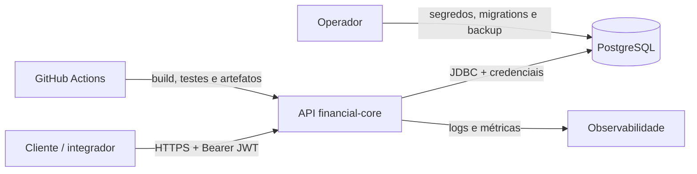

# Modelo de ameaças inicial — PayCore

| Campo | Valor |
| ----- | ----- |
| Status | Em revisão |
| Autor | Luis Felipe (com apoio de execução via Gartrol/OpenCode) |
| Data | 2026-11-09 |
| Depende de | [RFC-001](../rfc/RFC-001-visao-e-arquitetura-inicial.md), [Requisitos, invariantes e glossário](../requirements/requisitos-invariantes-glossario.md), [ADR-002](../adr/ADR-002-persistencia-postgresql.md) |
| Missão | M1–M3 (revisado na M3) |
| Próxima revisão | M2 (transferências e ledger) e M3 (eventos e integrações) |

## Objetivo

Identificar as ameaças relevantes para a fundação do PayCore, priorizá-las e registrar, para
cada uma, **dono, mitigação e risco residual aceito**. O modelo cobre o núcleo atual
(contas, autenticação e persistência) e antecipa as ameaças que as próximas milestones
introduzem (transferências, ledger, eventos e operação).

Este documento não é uma certificação de segurança. É um artefato vivo de engenharia:
cada risco residual tem um dono explícito e uma condição de revisão.

## 1. Escopo e método

- **Método:** STRIDE por categoria, com análise de ativos, fronteiras de confiança e
  priorização por probabilidade × impacto.
- **Ambiente:** laboratório fechado, saldos fictícios, sem dinheiro real e sem dados
  pessoais de produção. As metas de segurança são proporcionais ao escopo do portfólio.
- **Dentro do escopo:** API de contas, autenticação JWT, banco PostgreSQL, migrations,
  CI, segredos de laboratório e o desenho de transferências/ledger do M2.
- **Fora do escopo desta versão:** infraestrutura de produção real, conformidade PCI-DSS
  ou BACEN, fraude do mundo real, segurança física, dispositivos de cliente e engenharia
  social. Esses itens serão tratados como riscos de milestone futura quando aplicável.

### Premissas

1. O token é emitido por um provedor de identidade simulado, externo a este serviço.
2. O PostgreSQL local roda em uma rede de laboratório; em ambiente compartilhado, TLS,
   autenticação forte e backup gerenciado são obrigatórios.
3. O repositório é privado durante o desenvolvimento; a publicação do portfólio remove
   qualquer segredo e dado sensível antes de tornar o código público.
4. A operação é feita por uma pessoa que acumula papéis; os “donos” abaixo são **papéis de
   responsabilidade**, não pessoas distintas.

## 2. Ativos e fronteiras de confiança

| Ativo | Por que importa | Onde vive |
| ----- | --------------- | --------- |
| Ledger (journal entries e postings) | Prova contábil; violação quebra I-01/I-02/I-03 | PostgreSQL |
| Saldos e histórico de contas | Visão de negócio do cliente; vazamento ou alteração gera perda de confiança | Consultas derivadas dos postings |
| Chaves de idempotência e fingerprints | Impedem duplicidade e reuso indevido (I-04) | PostgreSQL |
| Identidade do proprietário (`sub` do JWT) | Base de toda autorização | Token + API |
| Segredo de assinatura JWT | Permite forjar qualquer identidade | Variável de ambiente |
| Credenciais do banco | Permitem ler/alterar o ledger | Variáveis de ambiente / operador |
| Pipeline de CI e artefatos | Define o que chega ao ambiente | GitHub Actions |
| Logs e traces | Investigação e auditoria (I-08) | Saída padrão / backend de observabilidade |

### Fronteiras

As fronteiras principais são: cliente→API, API→banco, CI→artefato e operador→segredos.
Cada uma é uma oportunidade de spoofing, tampering ou vazamento.

## 3. Ameaças STRIDE e mitigações priorizadas

Prioridade: **P0** bloqueia a entrega ou protege uma invariante; **P1** deve ser tratada na
milestone indicada; **P2** é melhoria contínua. O risco residual é sempre acompanhado de
uma decisão explícita de aceite e da condição que a revê.

### 3.1 Spoofing (falsificação de identidade)

| ID | Ameaça | Ativo/fronteira | Prob. | Impacto | Prior. | Dono | Mitigação | Status | Risco residual aceito |
| -- | ------ | --------------- | ----- | ------- | ------ | ---- | --------- | ------ | --------------------- |
| T-01 | Forjar ou reutilizar JWT para se passar por outro proprietário | Identidade / cliente→API | Média | Alto | P0 | Backend | HS256 com segredo de no mínimo 32 bytes fora do repositório; validar assinatura, `iss` e `sub` UUID; expiração curta; TLS em ambiente compartilhado; rotação de segredo | Parcial (validação implementada; TLS/rotação na M5) | **Baixo no laboratório** — aceito porque o segredo local é descartável e o ambiente é fechado. Revisar antes de qualquer ambiente compartilhado. |
| T-02 | Acessar conta de outro proprietário por IDOR (trocar ID na URL) | Contas / cliente→API | Alta | Alto | P0 | Backend | `ownerId` derivado exclusivamente do `sub`; consultas escopadas por proprietário; 403 para conta de outro dono e 404 para inexistente; testes de integração cruzados | Implementado | **Baixo** — aceito com cobertura automatizada de leitura de conta e postings. Revisar a cada novo endpoint. |
| T-03 | Serviço ou pipeline se passar por operador para obter credenciais | Segredos / CI→ambiente | Baixa | Alto | P1 | Plataforma | Segredos somente em variáveis de ambiente; menor privilégio; sem credenciais em arquivos; mascaramento no CI; identidade de workload na M5 | Parcial | **Médio** — aceito até a M5, quando entra identidade de workload e auditoria de acesso. |

### 3.2 Tampering (alteração indevida)

| ID | Ameaça | Ativo/fronteira | Prob. | Impacto | Prior. | Dono | Mitigação | Status | Risco residual aceito |
| -- | ------ | --------------- | ----- | ------- | ------ | ---- | --------- | ------ | --------------------- |
| T-04 | Alterar ou apagar postings já efetivados para esconder movimentação | Ledger / API→banco | Média | Alto | P0 | Backend | Postings append-only; sem `UPDATE`/`DELETE` na aplicação; trigger/permissões no banco; correção somente por lançamento compensatório (I-03); backup PITR | Planejado M2 | **Médio** — aceito até o ledger existir. Revisar no primeiro card de ledger. |
| T-05 | Persistir journal entry desbalanceado ou transferência sem par contábil | Ledger / API→banco | Média | Alto | P0 | Backend | Efetivação em uma única transação; validar `SUM(credits) = SUM(debits)` por moeda antes do commit; constraints de valor/direção; testes de invariante I-01 | Planejado M2 | **Baixo** — aceito com teste obrigatório e constraint; revisar se o schema mudar. |
| T-06 | Reutilizar a mesma `Idempotency-Key` com payload diferente ou adulterar o snapshot | Idempotência / cliente→API→banco | Média | Alto | P0 | Backend | Chave única por proprietário; fingerprint SHA-256 do payload; snapshot imutável; conflito 409 para fingerprint diferente; operação em andamento 409; teste de concorrência | Planejado M2 | **Baixo** — aceito com teste de 100 requisições concorrentes. Revisar na M3 com consumidores assíncronos. |
| T-07 | Alterar dependência ou artefato de build (supply chain) | Pipeline / CI→artefato | Média | Alto | P1 | Plataforma | Versões fixadas; lockfiles; revisão de PR; Dependabot/SAST na M5; branch protection; artefatos verificáveis | Parcial | **Médio** — aceito na M1 porque o build é local/CI e não há deploy automatizado. Revisar antes do primeiro deploy. |
| T-08 | Migration divergir do schema esperado ou ser editada depois de aplicada | Banco / operador→banco | Média | Médio | P0 | Backend | Flyway com checksums; migrations imutáveis; CI sobe banco limpo e aplica todas; padrão expand/contract para mudanças destrutivas | Implementado (base) | **Baixo** — aceito com CI em banco limpo. Revisar antes de produção. |

### 3.3 Repudiation (negação de autoria)

| ID | Ameaça | Ativo/fronteira | Prob. | Impacto | Prior. | Dono | Mitigação | Status | Risco residual aceito |
| -- | ------ | --------------- | ----- | ------- | ------ | ---- | --------- | ------ | --------------------- |
| T-09 | Cliente ou operador negar que solicitou/alteou uma operação | Auditoria / API→banco | Média | Médio | P1 | Backend | `correlation_id` por operação; histórico de estados com timestamp e motivo; logs estruturados; eventos imutáveis na M3 | Parcial (correlação prevista; histórico M2) | **Médio** — aceito até a M3. Revisar quando o histórico de transferências existir. |
| T-10 | Ação administrativa no banco sem atribuição a uma pessoa | Banco / operador→banco | Baixa | Alto | P1 | Plataforma | Roles nomeadas; sem credencial compartilhada; trilha de auditoria do provedor; IaC e revisão de mudanças na M5 | Planejado M5 | **Médio** — aceito no laboratório; revisar antes de ambiente compartilhado. |

### 3.4 Information disclosure (vazamento de informação)

| ID | Ameaça | Ativo/fronteira | Prob. | Impacto | Prior. | Dono | Mitigação | Status | Risco residual aceito |
| -- | ------ | --------------- | ----- | ------- | ------ | ---- | --------- | ------ | --------------------- |
| T-11 | Segredo JWT ou credencial de banco vazar em código, log ou histórico | Segredos / repositório e logs | Média | Alto | P0 | Segurança | Segredos apenas em variáveis; `.gitignore`; exemplos sem valor real; revisão de PR; secret scanning na M5; rotação imediata se houver exposição | Parcial | **Médio** — aceito durante o laboratório com segredo descartável. Revisar antes de publicar o repositório. |
| T-12 | Resposta de erro expor stack trace, SQL ou existência de conta alheia | API / cliente→API | Média | Médio | P0 | Backend | Envelope de erro estável; `internal_error` sem detalhes; 403/404 deliberados; logs com redação; testes de contrato | Implementado | **Baixo** — aceito com testes de erro. Revisar a cada novo handler. |
| T-13 | Listagem ou paginação retornar postings de outro proprietário | Contas / cliente→API | Média | Alto | P0 | Backend | Consulta escopada por proprietário; paginação keyset com cursor opaco; testes de acesso cruzado em conta e postings | Implementado | **Baixo** — aceito com cobertura de integração. Revisar ao adicionar filtros. |
| T-14 | Backup ou exportação sem criptografia e com acesso amplo | Dados / banco→backup | Baixa | Alto | P1 | Plataforma | Criptografia em repouso; acesso restrito; retenção definida; teste de restauração na M5/M6 | Planejado M5 | **Alto no laboratório** — aceito explicitamente porque não há dados reais e o banco é local. Revisar antes de qualquer dado sensível. |

### 3.5 Denial of service (indisponibilidade)

| ID | Ameaça | Ativo/fronteira | Prob. | Impacto | Prior. | Dono | Mitigação | Status | Risco residual aceito |
| -- | ------ | --------------- | ----- | ------- | ------ | ---- | --------- | ------ | --------------------- |
| T-15 | Payload gigante, muitas requisições ou paginação aberta esgotarem API/banco | API / cliente→API | Média | Médio | P1 | Plataforma | Limites de validação; limite de página; timeouts; pool de conexões; rate limiting na M3/M5; métricas de saturação | Parcial | **Médio** — aceito na M1; revisar no primeiro teste de carga (M2). |
| T-16 | Deadlock ou contenção de locks em transferências concorrentes derrubar o fluxo | Banco / API→banco | Média | Alto | P0 | Backend | Ordem determinística de aquisição de locks; transações curtas; timeout e retry idempotente; métricas de lock wait; teste de concorrência | Planejado M2 | **Médio** — aceito até o M2; revisar com o teste de duas transferências simultâneas. |
| T-17 | PostgreSQL indisponível ou corrompido interromper o núcleo | Banco / operação | Baixa | Alto | P1 | Plataforma | Health checks; backup/PITR; restauração ensaiada; HA gerenciada na M5; estado explícito para operações incertas (I-07) | Planejado M5 | **Alto no laboratório** — aceito porque o ambiente é local e recriável. Revisar antes de ambiente compartilhado. |

### 3.6 Elevation of privilege (elevação de privilégio)

| ID | Ameaça | Ativo/fronteira | Prob. | Impacto | Prior. | Dono | Mitigação | Status | Risco residual aceito |
| -- | ------ | --------------- | ----- | ------- | ------ | ---- | --------- | ------ | --------------------- |
| T-18 | Confusão de algoritmo JWT ou segredo fraco permitir forjar tokens | Identidade / cliente→API | Baixa | Alto | P0 | Segurança | Algoritmo fixo HS256; rejeitar `alg` inesperado; segredo mínimo; issuer obrigatório; testes de token inválido/expirado | Implementado (parcial) | **Baixo no laboratório** — aceito com segredo descartável e testes. Revisar antes de ambiente compartilhado. |
| T-19 | SQL injection em filtros, ordenação ou paginação | Banco / cliente→API | Média | Alto | P0 | Backend | JPA com parâmetros vinculados; ordenação em allowlist; nenhuma concatenação de SQL com entrada; SAST na M5 | Implementado (base) | **Baixo** — aceito com revisão e testes. Revisar ao adicionar filtros dinâmicos. |
| T-20 | Role da aplicação com privilégios de DDL/owner do banco | Banco / API→banco | Média | Alto | P1 | Plataforma | Separar role de migration e role de runtime; runtime só DML necessário; sem superuser; revisão de grants | Planejado M5 | **Médio** — aceito no laboratório com um único usuário. Revisar antes de ambiente compartilhado. |
| T-21 | Comprometimento do CI permitir push em `main` ou publicar artefato malicioso | Pipeline / CI→repositório | Baixa | Alto | P1 | Plataforma | Branch protection; revisão obrigatória; tokens de escopo mínimo; ambientes protegidos; artefatos assinados na M5 | Planejado M5 | **Médio** — aceito enquanto não há deploy automatizado. Revisar antes do primeiro release. |
| T-22 | Reuso de chave de idempotência por outro proprietário ou replay após timeout | Idempotência / cliente→API | Média | Alto | P0 | Backend | Escopo da chave por proprietário; fingerprint; snapshot; TTL maior que a janela de retry; resposta original em repetição legítima | Planejado M2 | **Baixo** — aceito com testes de concorrência e replay. Revisar na M3 com eventos. |
| T-23 | Valor negativo, overflow ou transferência sem limite explorar regras de saldo | Transferências / cliente→API | Média | Alto | P0 | Backend | `BIGINT` em centavos; `amount > 0`; limite por operação; validação de moeda; teste de borda; constraint no banco | Planejado M2 | **Baixo** — aceito com validação e constraint. Revisar ao alterar o modelo. |
| T-24 | Bypass do motor de risco ou falha silenciosa que aprove operação suspeita | Risco / M4 | Média | Alto | P1 | Backend | Decisão obrigatória para operações elegíveis; falha do risco resulta em `REVIEW`/`REJECT`, nunca aprovação silenciosa; timeout e circuit breaker | Planejado M4 | **Médio** — aceito até a M4; revisar no desenho do motor. |
| T-25 | SSRF: parceiro cadastra URL de webhook apontando para rede interna ou metadados | Webhooks / parceiro→integration-api | Média | Alto | P1 | Segurança | Validar esquema http(s), host obrigatório e ausência de credenciais no cadastro; na entrega resolver o host, aceitar apenas `unicast` público, desabilitar redirect, aplicar timeout e revalidar a URL; logs sem URL sensível; liberar rede privada apenas por flag de laboratório | Implementado | **Baixo no laboratório** — bloqueio ativo e coberto por teste; resta DNS rebinding entre resolução e conexão, aceito até existir conector que fixe o IP validado. Revisar antes de qualquer destino real. |
| T-26 | Vazamento ou força bruta da API key de parceiro permitir acessar dados alheios | Identidade de parceiro / parceiro→integration-api | Média | Alto | P0 | Segurança | API key vinda de ambiente, comparação em tempo constante sobre SHA-256, nunca logada; rate limit por parceiro; JWT de borda curto com `sub` derivado da configuração do servidor | Implementado | **Baixo no laboratório** — aceito com chaves descartáveis e testes de isolamento. Revisar antes de ambiente compartilhado. |

## 4. Priorização e decisão de risco residual

### Critérios

- **Probabilidade:** Alta = explorável com conhecimento público e sem acesso especial;
  Média = exige acesso autenticado ou condição específica; Baixa = exige comprometimento
  prévio de infraestrutura ou credencial.
- **Impacto:** Alto = quebra invariante financeira, vaza segredo ou afeta todos os clientes;
  Médio = afeta um cliente ou a operação; Baixo = degradação limitada e reversível.
- **Prioridade:** P0 = mitigar antes de expor o fluxo; P1 = mitigar na milestone indicada;
  P2 = melhoria contínua.

### Aceite explícito

Cada linha da seção 3 termina com um risco residual e a razão do aceite. O aceite vale
**somente para o ambiente de laboratório atual**. Qualquer uma das condições abaixo revoga
o aceite e exige reavaliação antes de continuar:

1. o ambiente passa a ser compartilhado ou acessível pela internet;
2. dados reais ou de terceiros entram no sistema;
3. um deploy automatizado passa a existir;
4. uma invariante financeira é implementada sem o teste correspondente;
5. um segredo é exposto, mesmo que de laboratório.

## 5. Controles transversais

| Controle | Estado atual | Lacuna conhecida | Dono |
| -------- | ------------ | ---------------- | ---- |
| Autenticação JWT e autorização por proprietário | Implementado para contas | TLS, rotação e identidade de workload | Backend/Plataforma |
| Segredos fora do repositório | Implementado por variáveis de ambiente | Secret scanning e cofre gerenciado | Segurança/Plataforma |
| Integridade do ledger | Desenhada na ADR-002 | Implementação e testes no M2 | Backend |
| Migrations reproduzíveis | Flyway + CI em banco limpo | Teste de restauração | Backend/Plataforma |
| CI com build e testes | `financial-core CI` | SAST, dependências e assinatura | Plataforma |
| Documentação de links | `docs CI` | — | Documentação |
| Observabilidade e auditoria | Logs básicos | Métricas, traces e retenção | Plataforma |

## 6. Registro de revisão

| Etapa | Resultado | Evidência |
| ----- | --------- | --------- |
| Revisar ativos e fronteiras | 8 ativos e 4 fronteiras mapeados | §2 |
| Revisar ameaças STRIDE | 26 ameaças classificadas e priorizadas | §3 |
| Registrar dono por ameaça | 26/26 com papel responsável | Coluna “Dono” |
| Registrar mitigação por ameaça | 26/26 com controle e status | Coluna “Mitigação” |
| Registrar risco residual aceito | 26/26 com decisão e condição de revisão | Última coluna + §4 |
| Revisão humana | Pendente (validação do card) | Entrega no Gartrol |

**Participantes da revisão:** Tech Lead, Backend, Plataforma, Segurança e Qualidade (papéis
acumulados pelo mesmo operador neste projeto). **Próxima revisão obrigatória:** início do M2,
antes de implementar transferências e ledger.

## 7. Riscos aceitos com maior visibilidade

| Risco | Por que foi aceito agora | Dono | Gatilho de revisão |
| ----- | ------------------------ | ---- | ------------------ |
| T-14/T-17 — backup e disponibilidade do PostgreSQL | Ambiente local, dados fictícios e banco recriável | Plataforma | Antes de ambiente compartilhado ou dado real |
| T-04/T-16 — integridade e concorrência do ledger | Ledger ainda não implementado; ADR-002 define o caminho | Backend | Primeiro card de transferências/ledger |
| T-07/T-21 — supply chain e CI | Sem deploy automatizado e repositório privado | Plataforma | Antes do primeiro release/deploy |
| T-11 — vazamento de segredo | Segredo local descartável e sem dados reais | Segurança | Antes de publicar o repositório |

## Referências

- [RFC-001 — Visão e Arquitetura Inicial](../rfc/RFC-001-visao-e-arquitetura-inicial.md)
- [Requisitos, invariantes e glossário](../requirements/requisitos-invariantes-glossario.md)
- [ADR-002 — Persistência transacional em PostgreSQL](../adr/ADR-002-persistencia-postgresql.md)
- [Autenticação e autorização de contas](../architecture/autenticacao-e-autorizacao-contas.md)
- [Padrão de documentação por milestone](../engineering/documentation-standard.md)
